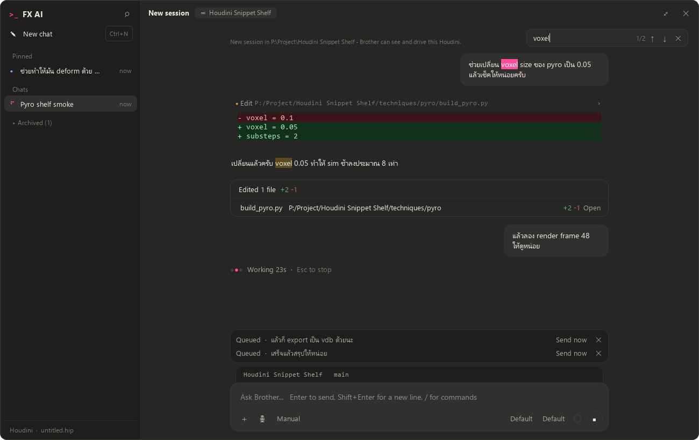

# Houdini Snippet Shelf

A working FX TD's shelf of Houdini techniques: paste-able Python builders that create the node
networks, and the VEX wrangles inside them. Every technique is checked headlessly in **hython
21.0.671** before it lands here. Houdini 20.5 is not tested yet.

The repo also holds **FX AI**, a Claude chat panel that lives inside Houdini, and an R&D
experiment that generates AI images and video from a Copernicus network.

> Technique notes are written in Thai; code, node names and comments are in English.

## Techniques

Each folder in [`techniques/`](techniques/) holds the latest version, with a README that says
where to paste each file and what it was tested with.

| Technique | Context | What it does |
|---|---|---|
| [RBD pieces → copy root geometry](techniques/RBD_pieces_to_copy_root_geometry/) | SOP, LOP | Copy the original pieces back onto a simmed RBD (packed or points), including a fractured-box builder and a USD PointInstancer version |
| [transform → orient + scale](techniques/transform_to_orient_scale/) | SOP | Turn `3@transform` (e.g. `packedfulltransform`) back into `p@orient` + `v@scale` / `f@pscale` |
| [Unborn particles → follow live](techniques/Unborn_particles_to_follow_live/) | SOP | Particles that are not born yet follow their live neighbours |
| [2 vectors → matrix / orient](techniques/2_vectors_to_matrix_orient/) | SOP | Build a matrix / orient from two vectors |
| [Subframe for changing topology](techniques/Subframe_for_changing_topology/) | SOP | Subframes for motion blur when the point count changes |
| [Surface distance from an edge group](techniques/Surface_distance_from_an_edge_group/) | SOP | Distance across the surface from an edge group |
| [My First Shot](techniques/My_First_Shot/) | OBJ | A starter shot setup |

### Using one

1. Open the technique's README to see which network to paste into.
2. Paste the `.py` builder into Houdini's **Python Shell** (or a shelf tool). It creates the
   nodes and prints what it made; most also pick up the frame range from your playbar.
3. The `.vfl` files are the same wrangle code on its own, for when you want to wire it by hand.

The builders never save your scene; undo with Ctrl+Z.

## FX AI: Claude inside Houdini

[`mcp/`](mcp/) contains two pieces:

- **The chat panel** (`mcp/houdini/brother_chat.py`): a PySide6 panel that runs the Claude Code
  CLI. Open it from the FX AI menu as a floating window, or as a pane tab via
  *New Pane Tab Type → FX AI*. It has chats you can search, pin and archive, queued messages,
  permission prompts, model and effort pickers, drag and drop, and voice input.
- **`houdini-live`** (`mcp/server.py` + `mcp/houdini/brother_link.py`): an MCP server that lets
  Claude look at the open Houdini session and, only when asked, change it, with one undo step per
  change. It listens on `127.0.0.1` only, and does nothing until you run `brother_link.start()`
  in that session.



Setup, the tool list and the design notes are in [`mcp/README.md`](mcp/README.md). You need your
own Claude Code login; nothing in this repo contains credentials.

## R&D: AI generation in Copernicus

[`rnd/cop_ai/`](rnd/cop_ai/) has two COP HDAs:

- **FX AI Angle** sets a camera orbit, elevation and distance.
- **FX AI Generate** sends the image and a prompt to Replicate (Seedream 5 Pro for images,
  Seedance 2.5 for video) and shows the result in the viewer.

Any Wrangle wired into an input becomes the prompt. This is an experiment. It needs your own
Replicate token in `$REPLICATE_API_TOKEN`, and every generation costs money.

## Tests

[`tests/`](tests/) re-runs the checks headlessly:

```
"C:\Program Files\Side Effects Software\Houdini 21.0.671\bin\hython.exe" tests\<file>.py <args>
```

The arguments (the builder and the `.hipnc` to test against) are listed at the top of each
script. The chat panel tests (`test_chat_panel_features.py`, `test_chat_pane_embedded.py`) need no
arguments: they run offscreen against a fake Claude session, so they never start the CLI.

## Layout

```
techniques/   latest version of each technique (README + .py builders + .vfl wrangles)
tests/        hython checks
hip/          the .hipnc scenes the techniques were built and tested in (Apprentice)
mcp/          FX AI chat panel + houdini-live MCP server
rnd/cop_ai/   Copernicus AI generation experiment
page/         the shelf web page (single HTML file) and what builds it
.claude/      Claude Code skills used to build, verify and publish techniques
```

The `hip/` scenes are Houdini **Apprentice** files (`.hipnc`). Their file caches (`geo/`) and
Houdini's backups are not in git.

## Notes

- Everything here is tested on Windows. Paths in a few scripts point at the author's machine;
  change them to yours.
- The shelf is also published as a single HTML page; `page/houdini-snippet-shelf.html` is the
  last published build.
